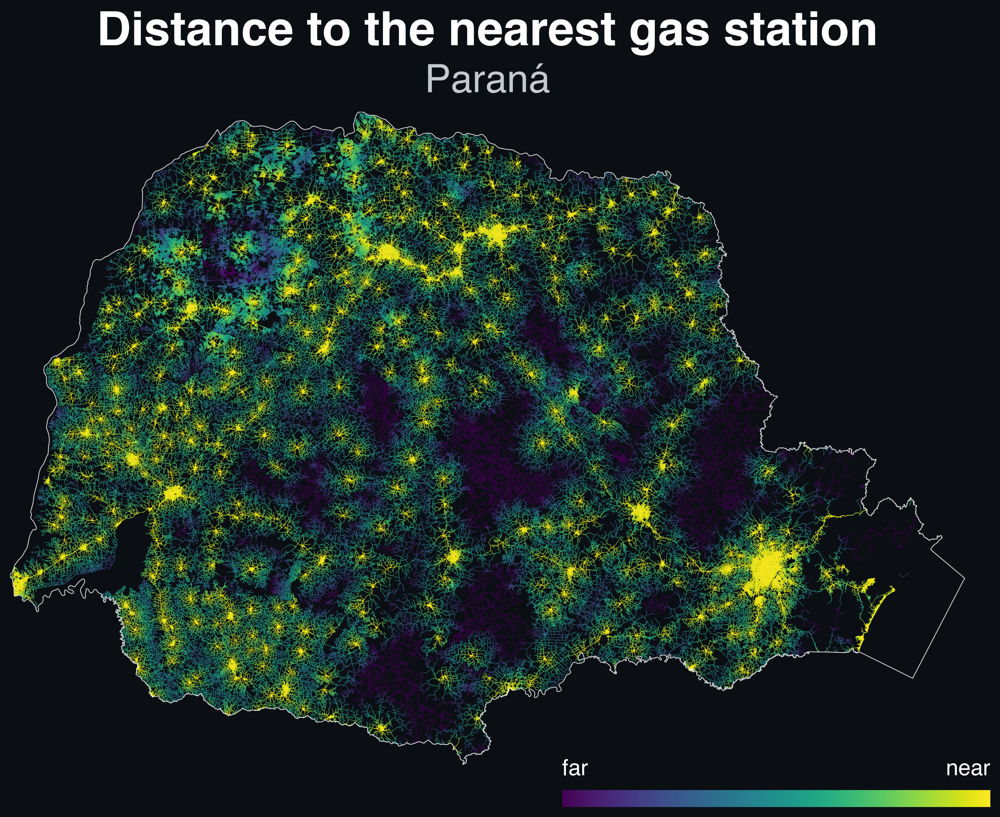

# Road-network accessibility maps

Two complementary dataviz analyses over the same
[Overture Maps](https://overturemaps.org/) road-network stack
([City2Graph](https://pypi.org/project/city2graph/) v1.0.0), sharing one graph
layer ([scripts/common/network.py](scripts/common/network.py)) that builds two
views of the network from the same raw segments:

| | **1. Walkability** | **2. Gas-station accessibility** |
|---|---|---|
| Question | how much street network can a pedestrian reach in 10 minutes? | how far must you drive to the nearest gas station? |
| Network view | pedestrian (`walk`) — motorways/trunk and foot-closed segments dropped | drivable (`road`) — only pedestrian/cycle-only classes dropped |
| Metric | reachable walkable network length inside the 10-minute isochrone | shortest road distance to the nearest station (multi-source Dijkstra) |
| Area | Curitiba, Maringá, São Paulo (city scale) | Paraná (state-wide) |
| Stations | — | [ANP public data center](https://cdp.anp.gov.br/ords/r/cdp_apex/consulta-dados-publicos-cdp/consulta-de-postos-lista) (*Agência Nacional do Petróleo, Gás Natural e Biocombustíveis*) |
| Scripts | [scripts/walkability/](scripts/walkability/) | [scripts/stations/](scripts/stations/) |

---

## 1. Walkability — reachable network length

<p align="center">
  
</p>

<p align="center"><em>Reachable walkable network length in Curitiba: for each
junction, the total length of the walkable network inside its 10-minute walking
isochrone. Dark purple marks dead-end corners that reach almost nothing; yellow
marks junctions in dense, fine-grained, well-connected street grids. Equivalent
maps are generated for Maringá
(<code>outputs/maringa/reachable_length.png</code>) and São Paulo
(<code>outputs/sao_paulo/reachable_length.png</code>).</em></p>

### What the map shows

For a junction `v`, **reachable length** `L(v)` is the total length of the
walkable network lying inside `v`'s 10-minute isochrone — the set of nodes
reachable from `v` within `600 s` at a single modeled walking speed of
**4.5 km/h** (≈ 750 m of travel). It reads as "how much network this junction
can reach on foot", and it peaks where a junction sits in a dense,
fine-grained, well-connected part of the network. A junction at the end of one
dead-end segment scores ~0.75 km (just that segment); a downtown junction can
reach ~35 km of streets in the same 10 minutes.

Each edge is credited a **partial share** equal to the fraction of its length
inside the isochrone (`min(1, f_u + f_v)`, where `f_x` is the fraction
reachable from endpoint `x`). The measure is therefore invariant to how finely
the network is digitized: splitting a road into more segments, or a long edge
whose middle lies outside the isochrone, cannot inflate the value.

### How it's computed

```
data/{city}/segment.geojson ─┐
data/{city}/connector.geojson ┘
        │  scripts/common/network.py  (load_segments, network="walk")
        │   keep subtype == "road"; drop motorways/trunk (no pedestrian access);
        │   drop segments fully closed to foot traffic (access_restrictions);
        │   drop sidewalk/crosswalk/driveway/parking subclasses (duplicates or
        │   private vehicle access); reproject; split at connectors and snap
        │   endpoints (≤5 m); assign travel time at 4.5 km/h
        ▼
data/{city}/walk_segments.parquet         (processed pedestrian network, cached)
        │  scripts/walkability/compute_reachable_length.py
        │   one Dijkstra per node (travel-time weighted, 600 s cutoff,
        │   numba-JIT, parallelised across cores with per-worker scratch reuse),
        │   each edge credited its partial isochrone share; only the largest
        │   connected component is computed (the rest is NaN)
        ▼
outputs/{city}/reachable_length.npy      (per-node reachable length, cached)
        │  scripts/walkability/plot_reachable_length.py
        │   clip to the municipal boundary, color by the endpoint mean,
        │   sequential viridis clipped to the 2nd–98th percentile
        ▼
outputs/{city}/reachable_length.png
```

The metric is computed on the *buffered* network (which extends beyond the
municipality), so junctions near the city edge are not starved of the network
just across the border; the drawing then clips to the municipal boundary. The
color scale is the **2nd–98th percentile** of the per-junction values inside the
municipality, so each city's gradient spans its own central range (the three
maps are not directly comparable color-by-color). Junctions in tiny
disconnected fragments (no value) are drawn faintly grey.

### Results

Reachable walkable network length, largest connected component of the buffered
network (per-junction, km):

| City | junctions | min | median | mean | max |
|---|---|---|---|---|---|
| Curitiba | 126,847 | 0.75 | 12.89 | 12.98 | 34.85 |
| Maringá | 36,195 | 0.75 | 11.93 | 12.51 | 36.00 |
| São Paulo | 435,573 | 0.75 | 15.88 | 15.13 | 37.70 |

São Paulo's denser, finer street grid shows up as a higher median and the
highest peak. The minimum is identical across cities: one dead-end segment at
the fringe of the network. Marília is configured in `CITY_CONFIGS` but has no
computed outputs yet.

---

## 2. Gas-station accessibility — distance to the nearest station

<p align="center">
  
</p>

<p align="center"><em>Distance to the nearest gas station in Paraná, along the
road network. Yellow hugs the stations; dark purple marks parts of the network
far from any station.</em></p>

A road-network accessibility map for the whole state of Paraná, Brazil: every
road segment is colored by how far you must drive along the roads to reach the
nearest gas station. Station positions come from the ANP registry, exported
from the agency's [public data center](https://cdp.anp.gov.br/ords/r/cdp_apex/consulta-dados-publicos-cdp/consulta-de-postos-lista)
(*Consulta de Postos*).

### What the map shows

- **yellow (near)** — the junction sits within a few hundred metres of a gas
  station along the streets.
- **dark purple (far)** — the junction is deep in a part of the network poorly
  served by stations, in some rural corners up to ~87 km of driving away.
- **grey** — roads that cannot reach any station at all (~0.3% of junctions, a
  handful of disconnected fragments).

Each road segment is colored by the distance from its location to the nearest
station: for a point at arc distance `x` along a segment of length `L` with
endpoint distances `d_u`/`d_v`, that is `min(d_u + x, d_v + (L − x))` — not the
endpoint mean, which overstates the middle of a long rural road. Segments longer
than 1 km are subdivided so the color follows that mid-segment peak. The color
scale is a **linear** `Normalize` between the 2nd and 98th percentiles of
in-state junction distances, so the gradient is not squeezed by the handful of
extreme outliers; distances outside that range saturate at the two ends of the
bar, labeled *near* and *far*. There is no other cap on the values — the
2nd–98th clip only sets where the color gradient lives.

### How it's computed

```
data/pr/segment.parquet ─┐
data/pr/connector.parquet ┘
        │  scripts/stations/parana.py  (load_road_segments)
        │   keep subtype == "road"; drop the pedestrian/cycle-only classes
        │   (footway, path, cycleway, steps, pedestrian); reproject to UTM 22S;
        │   split at connectors and snap endpoints (≤5 m); compute length_m
        ▼
data/pr/road_segments.parquet            (processed drivable network, cached)
data/all_gas_stations.xlsx               (ANP registry, every station with coordinates)
        │  scripts/stations/cleaning.py  (drop missing coordinates, aviation- and
        │   floating-fuel stations, and bogus shared coordinates)
        │  scripts/stations/compute_parana_distance.py
        │   keep stations inside the network bbox (any state), snap each to its
        │   nearest network node (≤100 m) → single multi-source Dijkstra
        │   (numba-JIT, edge weight = length_m)
        ▼
outputs/pr/station_distance.npy          (per-node nearest-station distance, cached)
        │  scripts/stations/plot_parana_distance.py
        │   trim roads to the state outline, color by true arc-length distance
        │   (subdividing long segments), draw as one LineCollection (near→far)
        ▼
outputs/pr/station_distance.png
```

The metric is a **single multi-source Dijkstra**: every station node is seeded
at distance 0 at once, so one pass yields the shortest road distance from every
junction to *any* station. The graph is undirected and weighted by physical road
length (`length_m`), not travel time — the question is "how far to the nearest
station", not "how long does it take".

### Results

The ANP registry lists **2,957** gas stations in Paraná; **726** have no
coordinates. After cleaning (aviation, floating and bogus-coordinate stations
removed), the metric is seeded with every station inside the network bbox —
**3,094** stations (**2,208** in Paraná, **886** in neighbouring states), snapped
to **2,880** unique network nodes (**178** dropped as farther than 100 m from any
node).

For the 864,299 in-state road-network junctions, the distance to the nearest
station:

| Statistic | Value |
|---|---|
| closest | 0 m |
| median | 2.29 km |
| furthest | 87.25 km |

| Share of junctions | within |
|---|---|
| 13.2% | 500 m |
| 29.5% | 1 km |
| 62.0% | 5 km |

The color scale is clipped to the 2nd–98th percentile of these distances, so the
gradient spans **0.12 km → 31.12 km** and the extreme rural tail saturates at the
"far" end. The far tail is shorter than in a Paraná-only run: seeding the
neighbouring-state stations lets border junctions reach a station just across
the line, cutting the furthest in-state distance from ~102 km to ~87 km.

---

## Shared network layer

[scripts/common/network.py](scripts/common/network.py) builds both analyses'
networks from the same raw Overture segments + connectors: the **walk** view
(pedestrian: motorway/trunk dropped, foot-closed segments dropped,
sidewalk/crosswalk/driveway/parking subclasses dropped, travel time at
4.5 km/h) and the **road** view (drivable: pedestrian/cycle-only classes
dropped, expressways kept). Both views are split at connectors, snapped at
≤5 m, reprojected to the city/state CRS, and cached to GeoParquet keyed to the
pipeline parameters and source files, so a parameter or data change invalidates
the caches automatically and re-runs are no-ops. The city maps' shared drawing
style (dark background, percentile clip, gradient legend) lives in
[scripts/common/plotting.py](scripts/common/plotting.py).

---

## Project structure

```
README.md
scripts/
├── common/
│   ├── __init__.py
│   ├── network.py                     # shared graph layer: walk/road views, cache keys
│   └── plotting.py                    # shared drawing for the city maps
├── walkability/                       # approach 1: reachable walkable network length
│   ├── __init__.py
│   ├── metric.py                      # the metric's definition (cutoff, version, cache key)
│   ├── compute_reachable_length.py    # one Dijkstra per node (10-min isochrone)
│   ├── plot_reachable_length.py       # draw the city map
│   └── test_reachable_length.py       # unit tests for the metric
└── stations/                          # approach 2: distance to the nearest gas station
    ├── __init__.py
    ├── shared.py                      # SNAP_M_STATIONS, snap_stations, print_stats
    ├── cleaning.py                    # drop non-car-fuel stations + bogus coordinates
    ├── data_quality.py                # audit the registry, write cleaned/dropped lists
    ├── parana.py                      # state network prep, CSR build, numba Dijkstra, station loader
    ├── compute_parana_distance.py     # compute the metric
    ├── plot_parana_distance.py        # draw the map
    └── verify_map.py                  # independent verification suite (58 checks)
data/
  curitiba/ maringa/ marilia/ sao_paulo/
    segment.geojson / connector.geojson   raw Overture segments (city + buffer)
    walk_segments.parquet (+.meta)        processed pedestrian network (cache)
    road_segments.parquet (+.meta)        processed drivable network (cache)
    boundary.geojson                      municipal boundary
  pr/
    segment.parquet / connector.parquet   raw Overture segments (state bbox)
    boundary.geojson                      cached state boundary
    road_segments.parquet (+.meta)        processed drivable network (cache)
  all_gas_stations.xlsx                   ANP gas-station registry
outputs/
  curitiba/ maringa/ sao_paulo/
    reachable_length.npy (+.meta)         per-node reachable length (cache)
    reachable_length.png                  the map
  pr/
    station_distance.npy (+.meta)         per-node nearest-station distance (cache)
    station_distance.png                  the map
    stations_used.csv                     the cleaned stations that feed the map
```

Every `.meta` sidecar holds the cache key for its sibling file, built from the
pipeline parameters and the source files' size + mtime, so a parameter change or
a re-download invalidates the caches automatically and re-runs are no-ops.

---

## How to run

```bash
# approach 1: walkability (per city)
.venv/bin/python scripts/walkability/compute_reachable_length.py --city curitiba
.venv/bin/python scripts/walkability/plot_reachable_length.py --city curitiba
# (also --city maringa | marilia | sao_paulo; metric self-test:)
.venv/bin/python scripts/walkability/test_reachable_length.py

# approach 2: gas-station accessibility (Paraná)
# 0. (optional) audit the registry and write the cleaned/dropped lists
.venv/bin/python scripts/stations/data_quality.py

# 1. compute the metric (skips if the cached .npy is valid)
.venv/bin/python scripts/stations/compute_parana_distance.py

# 2. draw the map
.venv/bin/python scripts/stations/plot_parana_distance.py

# 3. (optional) independently verify the map — 58 checks, ~6 min
.venv/bin/python scripts/stations/verify_map.py
```

Every step skips automatically when its cache is still valid; a parameter
change or a re-download of the raw data invalidates them.

---

## Data sources

| Dataset | Source | Used for |
|---|---|---|
| Road segments + connectors | [Overture Maps](https://overturemaps.org/) — `segment`/`connector` features for each city buffer and the Paraná state bbox | both analyses' road networks |
| Gas-station registry | ANP [*Consulta de Postos*](https://cdp.anp.gov.br/ords/r/cdp_apex/consulta-dados-publicos-cdp/consulta-de-postos-lista) export, saved as `data/all_gas_stations.xlsx` | approach 2 station positions |
| Municipal / state boundaries | geocoded via `city2graph.get_boundaries`, cached as `boundary.geojson` | clipping the maps |

---

## Verification

[scripts/stations/verify_map.py](scripts/stations/verify_map.py) re-derives the
gas-station map's claims from *outside* the pipeline and checks them against
external truth — published road distances, OSM/Nominatim geocoding, projection
theory, and published state dimensions — plus the rendered pixels themselves
(an affine transform is recovered from the drawn border alone, then 11
distances across the color scale are sampled and compared to their expected
colors). All **58 checks pass**: the shipped `.npy` equals an independent
networkx implementation exactly (31 subgraphs + 105 probe nodes), city-pair
distances match published values within ±2% (e.g. Curitiba→Paranaguá 90 km,
Curitiba→Foz 633 km, Maringá→Londrina 97 km), the 87.25 km maximum is
confirmed at Guaraqueçaba (served from Cananeia, São Paulo), 4 station
addresses geocode within 9–208 m of their registry coordinates, and every
sampled pixel matches its plotted value within 5 RGB units.

---

## Assumptions & limitations

**Walkability map**

- **One speed for everyone.** A single constant 4.5 km/h (the standard
  pedestrian design speed) converts distance to travel time; no slopes,
  crossings, signals or personal pace. The 10-minute budget is ≈ 750 m of
  travel.
- **Motorways and trunk roads are not walkable.** Motorways are
  controlled-access; `trunk` (expressways, rodovias, marginais) is dropped too
  because ~99% of its segments carry no foot-access tag — keeping them would
  treat expressway centerlines as walkable shortcuts across barriers.
  Everything else is kept, with segments genuinely closed to foot traffic
  removed via their `access_restrictions` rather than by class.
- **Duplicates removed.** Sidewalk, crosswalk and cycle-crossing geometries
  duplicate a road centerline the metric already counts (keeping them would
  reward areas digitized in more detail); driveways and parking aisles are
  private vehicle access, not pedestrian network.
- **Undirected connectivity.** One-way restrictions are ignored (they do not
  bind pedestrians, and Overture does not reliably encode them anyway).
- **Largest component only.** Junctions in tiny disconnected fragments have no
  value and are drawn grey.
- **Edge coloring is the endpoint mean**, a linear approximation along the
  segment — it slightly overstates the middle of a long edge (the
  gas-station map uses the exact arc-length rule instead).
- **2nd–98th percentile color range.** Each city's gradient spans its own
  central 98% of values; the tails saturate at the ends. This is a display
  choice, not a hidden cap on the data — the `.npy` values are unclipped.

**Gas-station map**

- **A driveable road along every road segment.** Overture does not reliably
  encode one-way or turn restrictions, so the graph is undirected and
  connectivity is assumed both ways. The metric is distance along the roads
  (`length_m`), not travel time. This is the standard free-flow simplification;
  it understates distance where one-way loops matter.
- **All drivable classes are kept.** Expressways and service roads (driveways,
  parking aisles) are kept alongside highways; only the pedestrian/cycle-only
  classes (footway, path, cycleway, steps, pedestrian) are dropped. Private farm
  tracks and driveways are therefore counted as drivable links, not barriers.
- **Station snapping.** Each station snaps to its nearest network node within
  100 m; stations beyond that are treated as off-network and dropped (~2% of
  Paraná stations). A station mid-block still counts even though it is not
  itself a junction.
- **Stations across the border.** Stations from neighbouring states inside the
  network bbox are seeded too, so border junctions reach a station just across
  the state line. Stations across the *international* border (Paraguay and
  Argentina) are not in the ANP registry and remain missing.
- **Station cleaning.** The registry is filtered before seeding: aviation-fuel
  suppliers (distributor `AIR BP` or an aviation-service name), floating
  (boat-fuel) stations, and stations on a coordinate shared by ≥5 others
  (geocoding/centroid artifacts) are dropped. GNV-only (natural-gas) stations
  are kept — they still fuel cars, just with CNG. The rules live in
  `scripts/stations/cleaning.py`; `scripts/stations/data_quality.py` lists every
  dropped row.
- **Registry completeness.** The ANP registry may miss unregistered private
  farm tanks (common in agricultural Paraná) and may include stations that have
  since closed, so the map reads "distance to a *registered* station", not
  strictly "access to fuel".
- **Edge coloring.** Each whole segment is colored by the true arc-length
  distance `min(d_u + x, d_v + (L − x))`, subdivided every ~1 km so the color
  follows the mid-segment peak; the few border segments trimmed by the clip fall
  back to the endpoint mean. The color scale is taken from per-junction values
  inside the state, so junctions are weighted equally rather than by segment
  count — which weights dense urban junctions more than sparse rural ones.
- **2nd–98th percentile color range.** The gradient spans the central 98% of
  distances; the tails saturate at the ends. This is a display choice, not a
  hidden cap on the data — the `station_distance.npy` values are unclipped.
- **No external validation** against observed drive times.

---

## Environment

- Python 3.12 in `.venv`
- `city2graph==1.0.0` (`process_overture_segments`, `segments_to_graph`, `get_boundaries`)
- `numba` (JIT-compiled Dijkstra)
- `geopandas` + `pyogrio` (geospatial I/O), `shapely` (geometry)
- `numpy`, `matplotlib` (compute + plotting)
- `pandas` + `openpyxl` (station Excel)
