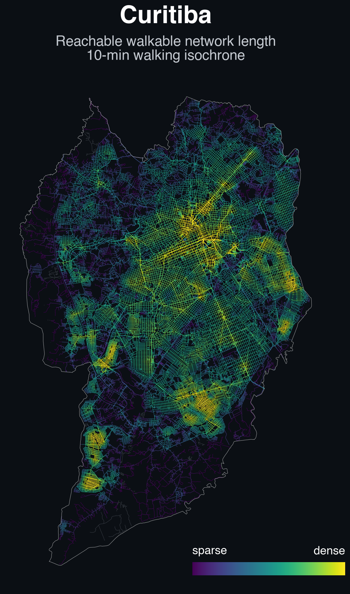

# Reachable walkable network length within a 10-minute walk

A geospatial-graph analysis built with
[City2Graph](https://pypi.org/project/city2graph/) (v1.0.0). It downloads the
walking network of a city **plus a surrounding buffer**, turns it into a graph,
and computes a single metric for every junction: **reachable walkable network
length** — the total walkable length that lies inside that junction's 10-minute
walking isochrone.

<p align="center">
  
</p>

<p align="center"><em>Reachable walkable network length in Curitiba — yellow
peaks in the fine-grained, connected districts; purple falls off toward the
coarse-grained or fragmented edges.</em></p>

The project ships with three cities — Curitiba, Maringá and São Paulo, Brazil —
chosen via a `--city` flag. The reachable-length approach reads as "how much
network can you actually reach from here on foot", and it peaks where a junction
sits in a dense, well-connected, fine-grained part of the city.

**Outputs** (one set per city):

- `outputs/{city}/reachable_length.png` — the map: each segment colored by the
  reachable walkable network length of its location.
- `outputs/{city}/reachable_length.npy` — per-node reachable walkable network
  length (metres), indexed by node id.

---

## What the map shows

For a single junction `v`, its 10-minute isochrone is the set of nodes it can
reach within 10 minutes at a modeled walking speed:

```
R(v) = { u : walk_time(v → u) <= 10 min }
```

**Reachable walkable network length** sums the length of the network inside that
isochrone, counting each edge only for the fraction of its length that lies
inside:

```
reachable_length(v) = Σ { fraction(e, v) × length(e) }
```

where `fraction(e, v)` is the share of edge `e` reachable from `v` within 10
minutes — an edge that crosses the isochrone boundary contributes only its
reachable portion.

- **yellow (high)** → the junction sits in — or can reach — a dense, connected,
  fine-grained part of the network, so 10 minutes of walking covers a large
  share of the local streets and paths.
- **purple (low)** → the junction is in a sparse, disconnected or coarse-grained
  area (cul-de-sac sprawl, superblocks, missing links), so the same 10 minutes
  reaches comparatively little network.

Because the walking speed is a single constant, the 10-minute budget is a fixed
~750 m of travel for every junction. The isochrone is therefore a fixed
*network-distance* ball, and the metric becomes close to a pure measure of

> **local walkable-network density × connectivity (permeability)**

— there is no speed gradient to confound it (no fast roads inflating the reach
of peripheral junctions). The values peak in the
fine-grained, connected districts and fall off toward coarse-grained or
fragmented edges.

> Speed is **modeled** (a single walking speed), not observed. The map shows
> *potential* reach, not actual walking times, and assumes a walkable footway
> along every road (see *Assumptions & limitations*).

---

## Project structure

```
README.md
data/
  curitiba/
    segment.geojson               raw Overture segments (city + buffer)
    connector.geojson             raw connector points (city + buffer)
    boundary.geojson              cached municipal boundary (plotting/summary)
    walk_segments.parquet         processed cache (walkable segments + speed)
    walk_segments.parquet.meta    cache key (params + source fingerprint)
  maringa/                        (same layout)
  sao_paulo/                      (same layout)
outputs/
  curitiba/
    reachable_length.png          ← the map
    reachable_length.npy          per-node reachable walkable network length (m)
    reachable_length.npy.meta     cache key
  maringa/                        (same layout)
  sao_paulo/                      (same layout)
scripts/
  download_data.py                (re)download the buffered Overture data
  citynet.py                      data prep + graph construction (shared)
  compute_reachable_length.py     compute the metric for every node
  plot_reachable_length.py        draw the map
  test_reachable_length.py        reference-check the metric kernel vs networkx
```

---

## Data files

### `data/{city}/segment.geojson` and `data/{city}/connector.geojson`

Raw Overture Maps `segment` and `connector` features for the municipal boundary
buffered by 2 km, so the walking reach of border junctions is not truncated at
the city limit. Downloaded by `download_data.py`:

```
PATH="$PWD/.venv/bin:$PATH" .venv/bin/python scripts/download_data.py --city curitiba
```

> The on-disk downloads are buffered 15 km around the boundary — a harmless
> superset of the 2 km buffer `download_data.py` requests. The extra buffer does
> not change any in-city result; a fresh run fetches the 2 km buffer.

### `data/{city}/walk_segments.parquet` (cache)

The processed, walkable segments with their walking speed. This is a **derived
cache** — `citynet.py` rebuilds it automatically from the two `.geojson` files
when it is missing or when the pipeline parameters / source files change (see
the `.meta` sidecar). The key is built from the source files' size + mtime, not
their path, so moving the project or renaming folders does not invalidate it.
Segments carry `length_m`, `speed_kmh` and `travel_time_s`, projected to the
city's UTM zone (metres).

### `outputs/{city}/reachable_length.npy` (cache)

NumPy array of per-node reachable walkable network length produced by
`compute_reachable_length.py`.

| | |
|---|---|
| dtype | `float64`, **metres**; `NaN` for nodes outside the largest connected component |
| indexing | `reachable_length[node_id]`, where `node_id` is the node index from the graph |

### `outputs/{city}/reachable_length.png` (the map)

Segments colored by `viridis` (dark purple = short reachable length → yellow =
long), color scale clipped to the 2nd–98th percentile of in-city junctions with
saturation arrows, drawn ascending so high-value segments plot on top, with the
city boundary overlaid and a colorbar. Segments with no value are drawn faintly
grey.

---

## Scripts

### `scripts/download_data.py` — (re)download the source data

Gets a city's boundary, buffers it by 2 km, and downloads Overture `segment` +
`connector` features for the buffered area into `data/{city}/`.

### `scripts/citynet.py` — data prep + graph construction (shared)

Imported by the compute and plot scripts. Key pieces:

| Name | Purpose |
|---|---|
| `CITY_CONFIGS` | Registry of cities: geocoding name, display name, CRS, and file paths under `data/{city}/`. |
| `SNAP_M = 5.0` | Endpoint-snapping threshold (metres). |
| `CODE_VERSION` | Bumped when the filtering/graph logic changes, so the caches rebuild. |
| `METRIC_VERSION` | Bumped when the metric's *definition* changes (e.g. partial-edge credit), so the `.npy` cache rebuilds even though the segments are unchanged. |
| `WALK_SPEED_KMH = 4.5` | Single walking speed (km/h) — 1.25 m/s, the standard pedestrian design speed. |
| `NON_WALK_CLASSES` | Road classes a pedestrian cannot walk on: `motorway`, `trunk`. Rail is excluded by the `subtype == "road"` filter. |
| `FOOT_MODES` | Overture `mode` tokens that mean a denial closes the segment to walking: `foot`, `pedestrian`. |
| `DROP_SUBCLASS` | Subclasses dropped as non-network: `footway` → `sidewalk`/`crosswalk`, `cycleway` → `cycle_crossing` (duplicate a road centerline), `service` → `driveway`/`parking_aisle` (private vehicle access). |
| `_fully_denied(value)` | True if a segment is closed to pedestrians along its whole length. |
| `load_segments(city)` | Return the processed walkable segments, rebuilding the parquet cache if needed. |
| `build_graph(seg)` | `segments_to_graph` → `(nodes, edges)` GeoDataFrames. |
| `load_boundary(city)` | Cached municipal boundary (projected). |
| `reach_cache_key(city)` | Hash of the metric version + parameters + segment cache — the `.npy` cache key, shared with the plot. |
| `parse_city()` | Parse `--city` (default `curitiba`). |

### `scripts/compute_reachable_length.py` — compute the metric

Produces `outputs/{city}/reachable_length.npy`.

| Name | Purpose |
|---|---|
| `CUTOFF = 600.0` | The walking-time budget (seconds) — 10 minutes ≈ 750 m. |
| `dijkstra_reachable_length(...)` | **Numba-JIT** Dijkstra weighted by walking time; returns the reachable walkable network length for one source, crediting each edge for the fraction of its length inside the isochrone (the partial-edge rule). Scratch arrays are owned by the caller and reused across calls, so each search costs O(touched nodes) rather than O(n). |
| `_component_ids(n, src, dst)` | Union-find over the collapsed edges. |
| `build_csr(nodes, edges)` | Collapse parallel edges to the shortest one, drop self-loops, build undirected CSR arrays (time + length weights), and return component ids. |
| `_compute_parallel(...)` | Multiprocess fan-out over the largest component with progress + ETA. |
| `main()` | Build the graph, keep the largest connected component, compute (or load the cache), and print stats for the buffered area and the city. |

### `scripts/plot_reachable_length.py` — draw the map

Produces `outputs/{city}/reachable_length.png`.

| Name | Purpose |
|---|---|
| `CMAP = "viridis"` | Sequential colormap. |
| `load_network(city)` | The walking network plus its boundary. |
| `attach(edges, boundary, values, column)` | Clip the network to the city with the metric attached per segment (mean of its two endpoints). |
| `node_mask(nodes, boundary)` | The junctions inside the boundary — the basis for the color scale. |
| `draw_map(...)` | Draw the map: 2nd–98th percentile scale (with saturation arrows), no-value segments faintly grey, ascending draw order, colorbar. |

The plot script validates the `.npy` cache key against the current parameters
and exits with a clear message if the metric is missing or stale, rather than
silently pairing fresh labels with old values.

---

## Pipeline

```
scripts/download_data.py
        │  buffer the boundary by 2 km, download segment + connector
        ▼
data/{city}/segment.geojson  ─┐
data/{city}/connector.geojson ┘
        │  scripts/citynet.py
        │   1. keep subtype == "road" (drops rail); drop non-walkable classes
        │      (motorway, trunk); drop segments closed to pedestrians (unconditional
        │      foot denials, or denials whose mode covers foot — not one-way,
        │      partial-length, or non-foot closures); drop non-network
        │      subclasses (sidewalk/crosswalk/cycle_crossing, which duplicate a
        │      road centerline, and driveway/parking_aisle, which are private
        │      vehicle access)
        │   2. reproject to the city's UTM zone
        │   3. process_overture_segments (split at connectors, snap ends ≤5 m)
        │   4. length_m, then travel_time_s = length / walking speed (constant)
        ▼
data/{city}/walk_segments.parquet
        │  scripts/compute_reachable_length.py
        │   build graph → keep largest component → CSR (drop self-loops)
        │   → one Dijkstra per node → walkable length inside the 10-min
        │     isochrone (partial-edge credit for frontier edges)
        ▼
outputs/{city}/reachable_length.npy
        │  scripts/plot_reachable_length.py   → outputs/{city}/reachable_length.png
        │   clip to the boundary, color by mean endpoint value
        │   (segments with no value drawn faintly grey)
```

---

## Methodology details

### Speed model

```
travel_time_s = length_m / (WALK_SPEED_KMH / 3.6)
```

`WALK_SPEED_KMH = 4.5` (1.25 m/s), the standard pedestrian design speed used in
walkability and accessibility literature. It is a single constant: the 10-minute
budget is therefore a fixed ~750 m of travel for every junction, and the
isochrone is a network-distance ball whose *Euclidean* extent varies only with
how grid-like the local street pattern is.

### Graph

- **Nodes** are unique segment endpoints / intersection points in the buffered
  area; only the largest connected component is analyzed (reach = `NaN` for the
  dropped fragments).
- **Edges** are the walkable segments, with parallel edges (a footpath alongside
  a road, a divided road with walkable frontage on both sides) collapsed to the
  shortest one between a node pair, and **self-loops** (segments whose ends
  snapped to the same node) dropped — a self-loop cannot affect reachability,
  and keeping it would double-count its length.
- **Undirected**. Pedestrians are not bound by one-way restrictions, so unlike a
  driving network the undirected assumption is correct rather than approximate.

### The metric, precisely

For each source node `s` in the largest component, one Dijkstra from `s` (edge
weight = `travel_time_s`, out to `CUTOFF = 600 s`) yields the shortest-path time
to every reached node. Each undirected edge `(u, v)` of travel time `w` and
length `l` then contributes `l × min(1, f_u + f_v)`, where
`f_x = max(0, (CUTOFF − dist(x)) / w)` is the fraction of the edge reachable
from endpoint `x`. The two one-sided shares are accumulated inside the same
Dijkstra (an edge is settled the moment its second endpoint is popped), so each
edge is counted exactly once and its total comes to exactly `min(1, f_u + f_v)`.

This **partial-edge rule** credits an edge crossing the isochrone boundary for
only its reachable portion, and makes the measure invariant to how finely a road
is split into segments: subdividing a road into more segments (or merging them
back) leaves the total unchanged, so digitization detail cannot inflate the
value the way an all-or-nothing "both endpoints inside" rule would.

---

## How to run

```bash
# 0. (re)download the source data — only needed once, or to refresh
PATH="$PWD/.venv/bin:$PATH" .venv/bin/python scripts/download_data.py --city curitiba

# 1. (re)compute the metric — skips if the cached .npy is valid
.venv/bin/python scripts/compute_reachable_length.py --city curitiba

# 2. draw the map
.venv/bin/python scripts/plot_reachable_length.py --city curitiba
```

Swap `--city maringa` or `--city sao_paulo` to run another city. Caches are
keyed to their parameters, source-file size + mtime, `CODE_VERSION` and
`METRIC_VERSION`, so editing the cutoff, the walking speed, the snap threshold,
the filters, the metric's definition, or re-downloading the data invalidates
them automatically.

---

## Adding a new city

Adding a city is a small change: **one config entry** in `scripts/citynet.py`,
plus the three pipeline commands. The walking speed, the 10-minute cutoff and
the 2 km buffer are shared across cities and need no edits.

**1. Add an entry to `CITY_CONFIGS`** (`scripts/citynet.py`):

```python
"campinas": {
    "geocode": "Campinas, São Paulo, Brazil",
    "display": "Campinas",
    "crs": "EPSG:32723",               # UTM zone for the city (see step 2)
    "source_segment": "data/campinas/segment.geojson",
    "source_connector": "data/campinas/connector.geojson",
    "cache": "data/campinas/walk_segments.parquet",
    "boundary": "data/campinas/boundary.geojson",
},
```

- `geocode` — any place name Nominatim resolves (passed to `get_boundaries`).
- `display` — label used in map titles and the stats printout.
- `crs` — a projected, **metre-based** CRS. Segment lengths and travel times
  are computed in this CRS, so it must be metric (a UTM zone, in practice).

**2. Pick the UTM CRS.** Curitiba and Maringá sit in UTM zone 22S
(`EPSG:32722`); São Paulo in 23S (`EPSG:32723`). For a city at longitude `lon`:

```
zone = floor((lon + 180) / 6) + 1
EPSG = 32600 + zone   if north of the equator   (e.g. 32623)
       32700 + zone   if south of the equator   (e.g. 32723)
```

e.g. Campinas (lon ≈ −47°): zone 23, southern hemisphere → `EPSG:32723`.

**3. Run the pipeline**, exactly as for Curitiba/Maringá:

```bash
PATH="$PWD/.venv/bin:$PATH" .venv/bin/python scripts/download_data.py --city campinas
.venv/bin/python scripts/compute_reachable_length.py --city campinas
.venv/bin/python scripts/plot_reachable_length.py --city campinas
```

The new key becomes a valid `--city` choice automatically (`parse_city` lists
`CITY_CONFIGS`' keys). The first pipeline step that needs it (`download_data`,
or `compute`/`plot` if the data already exists) geocodes and caches the
municipal boundary to `data/{city}/boundary.geojson`; everything else lands
under `data/{city}/` and `outputs/{city}/`.

---

## Environment

- Python 3.12 in `.venv`
- `city2graph==1.0.0` (data loading, `segments_to_graph`,
  `process_overture_segments`, `get_boundaries`)
- `numba` (JIT-compiled Dijkstra)
- `geopandas` + `pyogrio` (geospatial I/O), `shapely` (geometry)
- `numpy`, `matplotlib` (compute + plotting)
- `overturemaps` CLI (downloads Overture data)
- `pyarrow` (GeoParquet cache)

---

## Results

Reachable walkable network length, for junctions inside each municipal boundary
(10 minutes at 4.5 km/h):

| Statistic | Curitiba | Maringá | São Paulo |
|---|---|---|---|
| highest | 34.9 km | 36.0 km | 35.7 km |
| average | 15.8 km | 15.5 km | 17.1 km |
| lowest | 0.8 km | 0.8 km | 0.8 km |
| 5th–95th percentile | 4.6–25.9 km | 2.6–27.1 km | 5.4–26.1 km |

| Network | Curitiba | Maringá | São Paulo |
|---|---|---|---|
| walkable segments (after splitting at connectors) | 169,886 | 54,672 | 603,797 |
| nodes in largest component | 126,847 | 36,195 | 435,573 |
| edges (after collapse + self-loop drop) | 167,419 | 54,045 | 595,251 |
| total buffered walkable length (collapsed) | 15,353 km | 8,960 km | 46,042 km |

> "walkable segments" is the post-split count (segments are split at every
> connector point and snapped), so it is larger than the pre-split filtered count
> the pipeline prints.

Color scales are clipped to the 2nd–98th percentile of in-city junctions:
**≈3–28 km** (Curitiba), **≈2–30 km** (Maringá) and **≈3–28 km** (São Paulo).

The three maxima sit close together (≈35–36 km). For reference, a perfect 100 m
grid yields ~23 km under the same partial-edge rule, so these maxima are
*consistent with* cores that are effectively finer-grained than a 100 m grid
(block spacings well under 100 m, and/or extra links from alleys, footpaths and
diagonals) — an inference from the numbers, not a directly measured fact. The
metric itself only asserts that the peaks sit in the densest, most
well-connected districts; it does not identify the exact features behind them
(park path meshes, campuses, divided avenues, or a fine block grid).
A 10-minute walk covers a tiny slice of any city's total network — the busiest
junction reaches ≈0.40% of Maringá's walkable network, ≈0.23% of Curitiba's and
≈0.08% of São Paulo's. The metric is therefore a *local* measure: it is a pure
permeability field, peaking in fine-grained, well-connected districts rather
than near fast corridors.

The `lowest` value of 0.75 km is a dead-end junction: its isochrone extends a
full 750 m down its single incident edge and covers nothing else. The percentile
range shows such junctions are extreme outliers.

In-city junctions outside the largest connected component (drawn grey, without a
value): 2,066 of 70,442 (2.9%) in Curitiba, 912 of 17,346 (5.3%) in Maringá and
6,871 of 237,789 (2.9%) in São Paulo.

---

## Assumptions & limitations

- **A walkable footway along every road.** Overture does not reliably encode
  whether a road has a sidewalk, so the analysis assumes a pedestrian can walk
  along every non-motorway, non-trunk road edge. Separate `sidewalk`/`crosswalk`
  footway geometries are deliberately dropped to avoid counting a road
  centerline and its sidewalk twice; the cost is that the metric cannot tell a
  road *with* a sidewalk from one *without*. This is the walking analog of a
  free-flow assumption, and it overstates reach along roads that in reality
  have no footway.
- **Motorways and trunk are excluded by class.** Motorways are controlled-access
  highways with no pedestrian access. Roads Overture classes as `trunk` are also
  dropped: ~99% of their segments carry no foot-access tag, so keeping them would
  treat expressway centerlines as walkable shortcuts across barriers. Trunk is
  only 0.9–1.9% of network length, so this exclusion removes little aggregate
  reach — its effect is concentrated in a narrow band alongside the dropped
  corridors, which show as gaps in the maps. The cost is that a few genuine urban
  trunk avenues are excluded, and highway-like roads Overture classes as
  `primary` or below remain walkable (this exclusion does not address them).
  Other roads closed to pedestrians are removed via `access_restrictions` foot
  denials (`foot`/`pedestrian`).
- **Driveways and parking aisles are dropped** (service `subclass`), since they
  are private vehicle access rather than pedestrian network; `alley` is kept as
  a genuine permeable path.
- **Unmapped crossings fragment the network.** The connector file carries no
  pedestrian-crossing signal, so a footpath on one side of a road joins the one
  on the other side only if they share a connector point. Where crossings are
  not digitized, the pedestrian graph fractures at roads — the most common
  source of disconnected fragments and `NaN` nodes.
- **Barriers / grade separation are ignored.** `get_barriers=False`;
  `level_rules` are not used, so a 5 m snap can join a footpath to a road across
  a wall, or an underpass to the street above. For a walking network — where
  permeability is the very thing being measured — this is the main known bias.
- **Components**: only the largest connected component is analyzed. The dropped
  nodes are likely snapping failures — the 5 m threshold may leave real paths
  detached — and are drawn in grey, without a value.
- **Parallel edges**: collapsed to the shortest edge between a node pair, so a
  longer parallel path (a footpath beside a road, or the second side of a divided
  street) is discarded rather than summed.
- **Self-loops**: dropped (see *Graph* above). They are snapping artifacts of a
  few metres and cannot affect the metric.
- **Edge coloring**: each segment is colored by the mean of its two endpoints'
  values, a linear approximation to the continuous variation along the segment.
  The color scale itself is taken from the per-junction values inside the
  boundary, so junctions are weighted equally rather than by segment count.
- **Boundary rule**: each edge is credited for the fraction of its length that
  lies inside the isochrone (see *The metric, precisely*). A path just barely
  reachable at the 10-minute mark is therefore not dropped — it contributes its
  reachable portion — and the measure is invariant to how finely roads are split
  into segments. A dead end's minimum is a full 750 m down its single edge
  (0.75 km).
- **Boundary clipping**: segments are clipped to the municipal boundary with
  `keep_geom_type=True`; the handful that only graze the boundary are dropped
  rather than drawn, so they cannot appear as point markers.
- **No external validation** against observed walking times.
